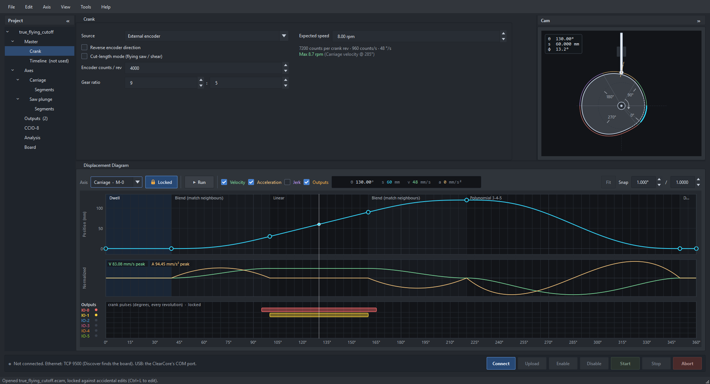
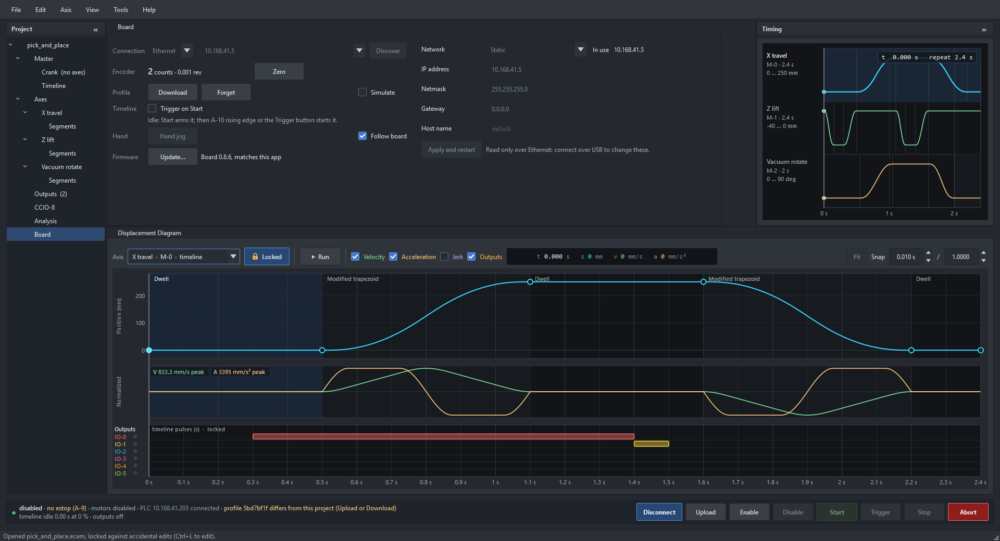
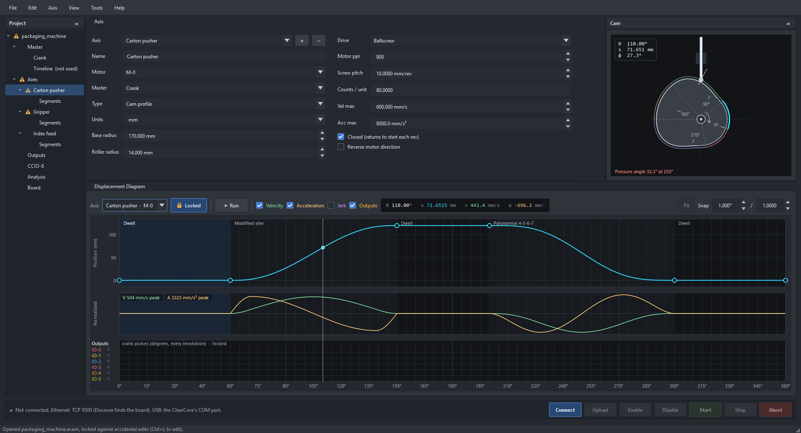
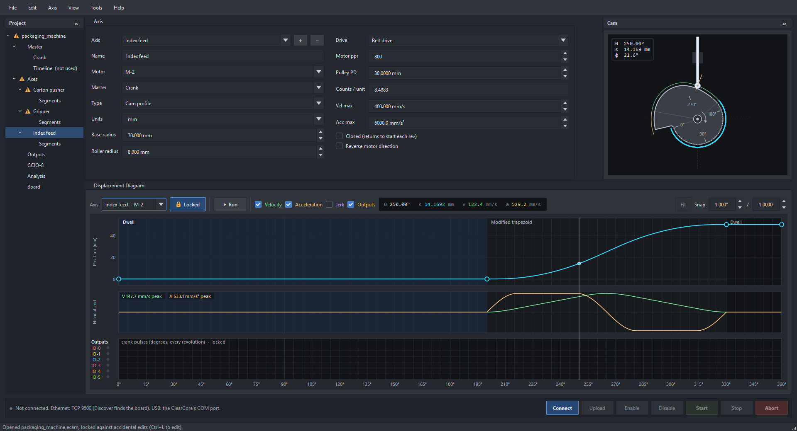
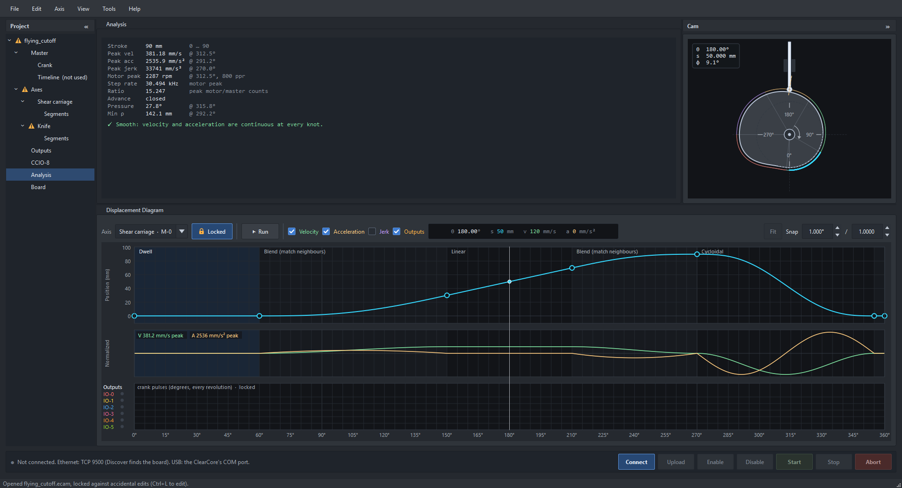
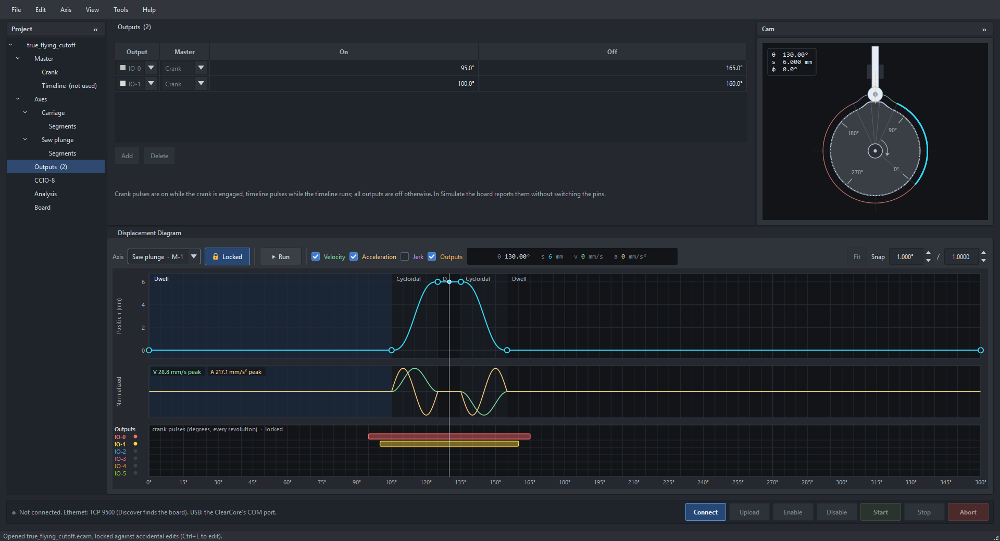
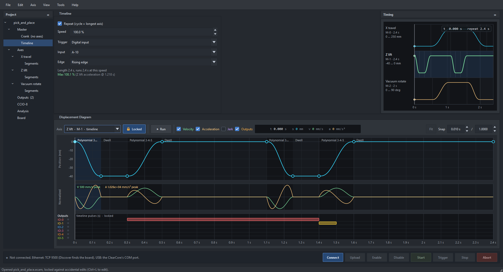

# Electronic CAM Workbench

Design, analyse and run electronic cam profiles on a Teknic ClearCore. Followers move as a function of
a **crank** (an encoder on the Encoder Adapter, or a crank motor the board drives itself) or of a
**timeline** (time from a trigger), and the project can switch the board's **outputs** IO-0..IO-5 on
the crank or the timeline. The app draws and checks the motion; the board keeps the profile in flash
and runs it from its 5 kHz sample interrupt, with nothing streamed while it runs.



**Videos:** the [YouTube playlist](https://www.youtube.com/watch?v=EWpQybInKNM&list=PLRxe8AWf5tZQ&index=1) has an
overview and nine how-tos: your first cam, the crank and timeline, motion laws, timeline waits, switches and
homing, axis jog, operator inputs, flying-saw cut length, and connecting a PLC.

**Experimental.** Not certified for production or safety-critical use. Keep a physical estop in the
circuit (the firmware can watch an input as one: `estop_pin`, A-9 by default, and `estop_mode`).

The math and algorithms behind it (motion laws, the Blend law, speed limits, the plate-cam geometry,
the board's integer runtime) are in [docs/MATH.md](docs/MATH.md).

**Documents** (PDF, Letter):

| Document | What it is |
|---|---|
| [User manual](docs/ECW_Users_Manual.pdf) (ECW-UM-100) | The in-app user guide (Help, F1) as a printed manual, made from the same pages |
| [Cam law mathematics and ClearCore theory of operation](docs/ECW_Theory_of_Operation.pdf) (ECW-TOP-100) | The motion laws, profiles, analysis and plate cams, then how the ClearCore runs them |
| [Math and algorithms](docs/ECW_Math_and_Algorithms.pdf) (ECW-MAR-100) | docs/MATH.md typeset: each formula with the code that implements it |

The executable is `ECamWorkbench.exe`. The repository, the `.ecam` file format tag and the app's
settings keep the name ECamUI; the firmware is `ECam_Firmware`.

## Quick start

The program opens with a splash screen, then the **start page**: **Guided setup**, **New project** (one axis
with a basic rise, dwell and return), **Open project**, one of the bundled **Examples**, or a **Recent
project**. Untick *Show this window when the program starts* to go straight to a new project; **File →
Start page…** brings it back.

**Guided setup** (also **File → New from guided setup…**, Ctrl+Shift+N) walks through a first project in five
steps, with a live preview of the motion and its peaks:

| Template | Master | What you set |
|---|---|---|
| Rise, dwell, return | encoder or driven crank | stroke; where the rise and the return start and end |
| Index feed | encoder or driven crank | feed per cycle and when it feeds (open profile) |
| Oscillate | encoder or driven crank | stroke and where it turns around |
| Triggered move | timeline, input or command | distance; wait, move, hold and return times |
| Flying cut-off | encoder wheel on the line (cut-length mode) | cut length, kerf, line speed; catch-up, ride and return angles; optional saw plunge axis and saw output |

Each step explains what it asks. There is a motor step for each motor (the flying cut-off has two: the
carriage, then the saw plunge); each covers the connector, units, drive (ballscrew, belt or
direct) and optional limits; the review lists the settings, any problems (connector clashes, velocity
jumps, limits, motor speed) and what to do next. The templates live in `core/CamTemplates.cpp`.

Then:

1. Or **File → Open** a sample from `samples/` (the Gallery below shows them; **File → Open example** has
   them built in).
2. Shape the motion in the **displacement diagram** (drag knots, double-click to split, right-click for
   the motion law) or type values into the **Segments** table. **Analysis** flags velocity and
   acceleration steps, pressure angle and undercut, and gives the peak motor speeds.
3. Set the master in the **Crank** or **Timeline** page and each axis's motor, drive and limits in the
   **Axis** page. Add output pulses in the **Outputs** band under the diagram.
4. On the **board strip** at the bottom: **Connect**, **Upload**. Tick **Simulate** on the **Board** page, then
   **Start**. Turn the encoder (or use **Hand jog**) and watch the cam and the diagram follow the board.
   Untick Simulate and **Enable** to run the motors.

## The window

- **Left: Project tree** (F9 or « to hide): the project's master, axes and their segments, outputs,
  CCIO-8, analysis and board. Clicking a node opens it in the detail pane; right-click an axis for the Axis menu.
  A red or amber triangle marks an error or warning from the project review; hover over the node to read
  it. A heading and the project show the worst thing under them.
- **Top:** the **detail pane**: whatever the tree has selected, so the diagram stays in view while you
  edit. A segment clicked in the diagram opens *Segments*. Beside it, the selected crank axis drawn as a
  plate cam, or the **Timing** view of every timeline axis. The Timing view shows when a timeline axis is
  selected, or with **View › Timing view** (Ctrl+T) whatever is selected. Shift+F9 or » folds it away.
- **Below them:** the **displacement diagram** of the selected axis, full width: position, then velocity,
  acceleration and jerk on request, then the **Outputs** band.
- **Bottom:** the **board strip**: a light (grey not connected, green connected, amber the PLC has
  control, red fault), what the board is doing, and Connect, Upload, Enable, Disable, Start, Stop and Abort,
  always in view. The address, Download, Forget, Simulate and Hand jog are on the *Board* page.
- **Board page, Network:** the board's DHCP or static mode, IP address, netmask, gateway and host name, and
  the address it's using now. They can be changed over USB, with the motors disabled and no PLC in control:
  **Apply and restart** saves them, restarts the board, reconnects and reads them back. Over Ethernet they
  are read only, because a new address would take away the link it was set on, and USB reaches a board
  whatever its address. On DHCP the IP address is the fallback, used if no server answers.
- **CCIO-8:** expansion boards on COM-1, up to 8, for future Home and Limit switches (normally closed). The tree's
  **CCIO-8** node holds the board count and each input's name, function and axis, kept with the project, and shows
  the link and inputs live. A broken link reads every input as Off, as a tripped sensor would. The board looks for
  boards when it starts and the page shows what it found. A profile uploaded with a count of 0 turns the link off, so
  boards it doesn't use can't raise a fault; upload one with boards to turn it on. Nothing acts on the inputs yet.
- **Firmware:** the app carries the firmware it needs (`firmware\` in the install folder: `.bin`, `.uf2`, the
  flasher). The Board page compares it with the board's. **Update…** (or **Tools > Update board firmware**) puts
  it on over USB, on an ECam board or a new one. A profile on the board is saved to a file first, checked
  against the board's hash, and put back after; the file goes only once the board has the same hash in flash, so
  an update that stops part way can be finished from the bootloader without losing it: double-tap the board's
  reset button (the IO-0 to IO-5 lights walk), press **Refresh** and update again. Without the app, copy
  `ECam_Firmware.uf2` to the `CLEAR_BOOT` drive a board in its bootloader shows.

The layout is remembered.

## Masters

One firmware, up to 4 axes (one per motor connector). Each axis picks its master, and both kinds run
at once:

- **Crank:** x is the crank angle, 0–360°, repeating every revolution. The crank is either an
  **external encoder** on the Encoder Adapter, or a **driven crank**, a motor the ClearCore runs itself
  (connector, ramp in rpm/s, motor max rpm). With axis velocity / acceleration limits set, the Crank
  page gives the highest safe crank speed, including the extra s′·α acceleration followers feel while
  the crank ramps.
- **Timeline:** x is time in seconds from a t = 0 shared by every timeline axis. Each axis has its own
  duration (drag its last knot sideways, or set Duration in the Axis page) and rests at its end
  position after it. The timeline is started by a trigger (a digital input and edge, or the Trigger
  button / `trigger` command, or a PLC's TRIGGER bit over EtherNet/IP) and runs at a speed override. Its length
  is the longest timeline axis or the last timeline output pulse, whichever ends later: one-shot it
  stops there (*done*, Trigger runs it again), repeating it wraps to 0. Limits give the highest safe
  override.

**Encoder input** (Teknic CL-ENCDR-DFIN adapter): A and B on DI-6 / DI-7 go to the ClearCore's hardware
quadrature decoder, which counts every edge, so **counts / rev is 4 × the encoder's line count**; the
index (DI-8) is not used yet. If the line or crank moving forward makes the count go down, tick
**Reverse encoder direction** (Crank page; applied by the board at Upload) rather than swapping wires.
The Board page's **Encoder** row shows the live count, also in encoder revolutions and (cut-length mode)
mm of line, with a **Zero** to measure from (in the app only). Bringing an encoder up:

1. Connect and watch the Encoder row: it should count **up** as the line moves forward
   (otherwise tick Reverse encoder direction and Upload again).
2. Press **Zero** and turn the encoder one revolution: the row reads 1.000 rev (the counts / rev you
   entered). With a measuring wheel,
   1 m of line is the counts per mm × 1000.
3. Upload, tick **Simulate**, **Start**, and move the line: the cam view and the diagram follow it.

No encoder at hand? Tick **Simulate**, **Start**, then **Run** in the **Sim encoder** row: the board moves
a simulated count at the speed you set and everything follows it as it would a real line.

**Cut-length mode** (flying saw, laser, shear): an encoder measures the line, or a driven crank's motor
feeds it, and the
cut length can change while running, see [Variable cut length](#variable-cut-length).

Changing an axis's master keeps its motion: crank → timeline maps one revolution at the current crank
speed onto seconds; timeline → crank stretches the duration to 360°.

**Trigger inputs:** IO-0..IO-5, DI-6..DI-8 and A-9..A-12, except the Encoder Adapter's DI-6..DI-8 while
an encoder is the master, an IO pin used as an output, and the board's estop input. The Input list
greys out the ones that cannot be used, and the board refuses them.

## How a profile is defined

An axis is a list of **segments** over its master (0–360° on the crank, 0–duration on the timeline).
Each segment has an end, an end position (axis units) and a **motion law**; it starts where the
previous one ended. Segment boundaries are **knots**: knot 0 is at x = 0 (`startPos`), the last knot at
360° (crank) or at the duration (timeline).

| Law | Ends at rest | Notes |
| --- | --- | --- |
| Dwell | — | no motion; its end is tied to its start |
| Linear | no | constant velocity; velocity steps at both ends unless its neighbours match (Blend) |
| Simple harmonic | yes | acceleration steps at the ends |
| Cycloidal | yes | zero acceleration at the ends |
| Modified trapezoid | yes | lowest peak acceleration (Ca 4.888) |
| Modified sine | yes | low peak velocity (Cv 1.760) |
| Polynomial 3-4-5 / 4-5-6-7 | yes | 4-5-6-7 also has zero jerk at the ends |
| Blend (match neighbours) | no | starts and ends at the neighbouring segments' velocities with zero acceleration (quintic): joins a dwell to a linear sync segment smoothly. Between two rests it is the 3-4-5 polynomial |
| Cubic spline | no | consecutive Spline segments are one smooth (C²) curve through their knots: for a shape given by points. Takes its neighbours' velocities at its ends; around a whole cycle it is periodic. See [docs/MATH.md](docs/MATH.md) |

- **Closed** profiles return to the start every revolution (the last knot is tied to knot 0). **Open**
  profiles advance by `end − start` every revolution or cycle (index feeds).
- A timeline axis must start and end at rest; a velocity step there is flagged like any other.
- Units are free text (`mm`, `deg`, …); counts / unit converts to motor steps.

The model, the laws, the upload format and the cam runtime live in `core/`: no Qt, and kept to C++14 so
the same files build into the app (C++17) and the firmware (the ClearCore's GCC 6). Each law is
evaluated in closed form (`ecam::EvaluateLaw(law, u)` → s, v, a, j for u ∈ [0, 1]); a Blend segment
also needs its neighbours (`ecam::EvaluateSegment`). The formulas are in [docs/MATH.md](docs/MATH.md).

## Editing

- **Displacement diagram:** drag a knot (Shift: vertical only, Ctrl: horizontal only, Alt: no snap;
  snap sizes in the diagram's bar). Dwells move with their knots. Double-click to split a segment,
  right-click for law / delete. Click or drag to scrub the master.
- **Cam view:** drag to turn the cam, wheel steps 1° (Shift 10°). The cam turns clockwise, the follower
  is a translating radial roller at 12 o'clock; the dashed orange line is the contact normal (pressure
  angle). Base and roller radius only affect this drawing and the DXF.
- **Segments table:** law per row; double-click a cell to type an end, span, position or rise.
- **Analysis:** stroke, peaks at the master speed, motor step rate and rpm, and warnings for velocity
  steps (infinite acceleration), acceleration steps (infinite jerk), pressure angle > 30° and undercut.
  Red / orange triangles in the diagram mark the knots with steps.
- Undo / redo for every edit; a drag is one step.

## Outputs

The project switches **IO-0..IO-5** with **pulses**. Outputs belong to the whole project, not to an axis,
and each pulse picks its master:

- **Crank pulse:** on from *a* to *b* crank degrees (0–360), every revolution, like a cam switch; on while
  the crank is engaged (following the encoder, running, stopping, hand jog).
- **Timeline pulse:** on from *t₁* to *t₂* seconds of timeline time, so it follows the speed override,
  repeat and hand jog with the timeline axes; on while the timeline runs. A project with timeline
  pulses but no timeline axis still has a timeline.

Up to 32 pulses in all (at least 0.1° / 1 ms each). **Every output is off** when its master is not
running: idle, armed, done, after Stop, Abort, a fault or the estop.

- **Outputs band** (bottom of the displacement diagram): a lane per output, each in its own color, on the
  selected axis's x-axis, so a crank axis shows the crank pulses and a timeline axis the timeline pulses;
  the other master's pulses are counted, greyed, in their lane. Double-click a lane to add a pulse (10° or
  0.1 s), drag a pulse to move it (also onto another lane), drag an end to change its on or off,
  right-click to delete; it snaps like the knots (Alt: none). The lamp beside each label shows the output
  at the cursor, the square the board's output when it runs this project. The **Outputs** check box hides
  the band; in a short diagram the lanes shrink so the curves keep most of the height.
- **Outputs page**: every pulse as a table (output, master, on, off) to type exact values.
  Add puts a pulse at the cursor on the selected axis's master; changing a pulse's master converts it at
  the expected crank speed.
- **Simulate does not switch the pins.** The board still runs and reports the outputs (status line and
  the band's lamps), so a simulation never fires a real actuator.

## Variable cut length

For a flying saw, laser or shear the cut length usually changes on the fly. Tick **Cut-length mode** in
the Crank page (encoder master):

- The encoder measures the line: **Encoder counts / rev** and the measuring **Wheel** circumference give
  the counts per mm. The profile is drawn over one cut of the **Design length** (360° = the design
  length); the diagram's axis then reads in mm of line. **Line speed** (m/min) replaces the crank speed.
- **Kerf:** the material the cut removes (saw blade, laser; 0 for a shear). A finished piece is the cut
  to cut distance less the kerf, so the board makes each cycle the piece plus the kerf.
- **What stretches:** the **wait** at the start of the cycle, where every crank axis dwells. The rest
  (accelerate, sync, decelerate, return) keeps its line distance, so its speeds, the limits and the
  carriage's motor speeds are the same at every length: the Crank page gives one **max line speed**
  for all lengths. Every crank axis must start with a dwell, and crank output pulses come after it.
- **The cut line.** The length you set is the line distance from one cut to the next on the material.
  The carriage leaves home while the next cut line is still upstream of the blade, accelerates (Blend),
  and reaches line speed exactly on it at the start of the **sync** (the carriage's Linear segment); the
  blade then rides the cut line through the sync, wherever in it the saw comes down. A new length only
  changes the wait, so the carriage still starts the same distance before the cut line arrives. The
  diagram shades the sync window (**sync / cut**). The Board page's Cut length row shows the live
  **blade to cut line** distance in mm: it counts down through the wait, closes more slowly while the
  carriage accelerates, and reads **on the cut line** (with the sync left) through the sync; after it, the
  next cut line, at the new length if one is pending.
- **Shortest piece** = design length − wait − kerf (the carriage must be home before the next cut);
  there is no longest. The Crank page shows it.
- **On the board:** the **Cut length** row in the Board page (or `length <mm>`) sets the finished
  piece length. It takes effect with the **next cut**: the cut under way finishes at its old length.
  Below the shortest piece it is refused. The status shows the length being cut and the next one. While
  hand jogging, a new length waits until the jog ends (jog targets are in turns of the current length).

`samples/variable_length_cutoff.ecam` is a flying saw drawn for a 600 mm cycle with a 3 mm kerf, on two
motors: the carriage (M-0) waits 280 mm, blends up to line speed, rides the line for 60 mm while the saw
(M-1, 5 mm ballscrew) plunges 6 mm, blends down and returns; the saw motor (IO-0) and a clamp (IO-1) are
crank outputs. Pieces from 317 mm up; at the expected 5 m/min both motors stay under 1000 rpm.
The math is in [docs/MATH.md](docs/MATH.md#10-the-runtime-on-the-clearcore).

## Electronic gear

An axis's **Type** can be **Electronic gear** instead of Cam profile: it has no diagram and follows the crank
at a whole-number ratio, `num` units of its travel for every `den` crank revolutions (negative reverses it).
3 : 2 on a `rev` axis is three revolutions for two; 5 : 1 on a ballscrew in mm is 5 mm per crank revolution. It
works from an encoder or a driven crank, and starts, ramps, stops and jogs with the crank. In cut-length mode the
ratio is per cycle as drawn, so it holds its speed against the line while the cut length changes.

The board keeps the ratio exact, in whole numbers with the remainder carried: 3 : 7 does not drift, however
long it runs, and running the master back brings the axis back to the count
([docs/MATH.md](docs/MATH.md#10a-the-electronic-gear)). The sample `samples/bench_gear.ecam` runs on M-0 and M-1.

## Mechanics

- **Direction:** **Reverse motor direction**, on an axis's page or a driven crank's, turns a motor that runs the
  wrong way without touching the drive. It flips only the step output: positions, the diagram and the board's
  counts stay as drawn. Upload to apply it.
- **Axis drive:** *Direct* (counts / unit typed in), *Ballscrew* (motor ppr ÷ screw pitch) or *Belt*
  (motor ppr ÷ (π × pulley pitch diameter)); pitch and PD are in the axis's units. E.g. 800 ppr on a
  5 mm screw = 160 counts/mm. Analysis shows the peak motor rpm each axis needs, and a driven crank's
  motor rpm.
- **Crank:** ppr × gear ratio = master counts per crank revolution (motor ppr for a driven crank,
  encoder counts per rev for an encoder). The ratio is a fraction, motor or encoder turns : crank turns
  (10 : 1 is a 10× reduction; a gearbox or measuring wheel that is not a whole ratio goes in as e.g.
  50 : 7). It stays exact on the board, which counts in 1/denominator of a count: 800 ppr at 50 : 7 is
  5714.29 counts per crank turn, and every 7 crank turns are exactly 40000 motor steps, so the crank's 0°
  never creeps.

## Running it on the ClearCore

`Firmware/ECamFirmware` is the ClearCore firmware (Microchip Studio project, same layout as ClearHPGL;
`libClearCore` and `LwIP` are vendored from the
[Enhanced ClearCore Library](https://github.com/AGSweeney/EnhancedClearCoreLibrary), which adds the
sample callback and external step mode it runs on). The console protocol is in
[Firmware/PROTOCOL.md](Firmware/PROTOCOL.md).

The firmware is also an **EtherNet/IP adapter** (QuickEIP, vendored in `QuickEIP/`): a PLC or any
EtherNet/IP tool finds it (vendor 65000, product 3, "ECam ClearCore"), opens Class 1 connections to
assemblies 150 / 100 / 151, and can set its IP address, DHCP / static and host name. The PLC reads the
machine's state (160 bytes) every RPI and, holding PLC_CONTROL, enables, starts, stops, triggers and jogs it
and sets the crank speed, timeline override and cut length (64 bytes); a lost connection stops the machine
in a controlled way. The EDS is `Firmware/eds/ECam_ClearCore.eds`; the user guide's chapter
*PLC (EtherNet/IP)* has the maps, the rules and the PLC setup, and
[Firmware/PROTOCOL.md](Firmware/PROTOCOL.md) the identity, the objects and the assembly tables.



The **Board** page and the **board strip** under the diagram do it all from the app. The strip is always in
view and holds Connect, Upload, Enable, Disable, Start, Trigger, Stop and Abort:

| Row | |
|-----|---|
| **Connection** | Ethernet: **Discover** finds the board (UDP 9502), or type its IP. USB: pick the ClearCore's COM port. **Connect**. |
| **Sim encoder** | With an encoder master while simulating: a speed (m/min of line in cut-length mode, crank rpm otherwise) and **Run** / **Stop**. The board then follows a simulated encoder count it advances itself, exactly as it would a moving encoder (outputs, next-cut length changes and all); the Encoder row shows it. Unticking Simulate goes back to the real input. |
| **Encoder** | With an encoder master: the live count, the same in encoder revolutions and (cut-length mode) mm of line, and **Zero** to measure from here (in the app; the board's count is not changed). |
| **Profile** | **Upload** (on the strip) sends the project; the board's hash must match the app's (status: "profile … = this project"). The board keeps the upload in flash and loads it again at power-up, motors disabled and nothing started. **Download** opens the board's project as a new, unsaved project, exactly as uploaded (or says it is the one already open). **Forget** erases the stored copy (it cannot be undone) and restarts the board so it comes up empty; the app reconnects. While anything moves it only erases, and the profile runs until the next restart. |
| **Motors** | **Enable** / **Disable** (on the strip) the motors the profile uses, or tick **Simulate** to run without stepping them (or switching outputs): simulating never needs the motors enabled, or even connected. **Clear fault** (shown while a fault is latched) clears it without enabling; ticking Simulate clears it too. |
| **Run** | On the strip. **Start**: crank axes engage (a driven crank ramps up) and the timeline arms. **Stop** ramps to rest, **Abort** stops at once. |
| **Cut length** | Only in cut-length mode. The finished piece length (the board adds the kerf) and **Set**: it applies from the next cut. Beside it, the length being cut, the next one and the shortest allowed. |
| **Timeline** | Only when the project uses the timeline. **Trigger** (on the strip) starts an armed (or finished one-shot) timeline from t = 0; it is greyed, with the reason in its tooltip, before Start and while running. **Trigger on Start** makes Start fire it too, so no physical input is needed. The line below says what the timeline is doing and what starts it (e.g. "Armed: waiting for A-10 rising edge or the Trigger button."). |
| **Hand** | **Hand jog** drives the motors by hand: drag the cam (or use the wheel), or scrub the displacement / timing view, and the board's master goes there with every motor following its profile (a driven crank's motor turns too). Turning the cam round keeps adding revolutions. Speed is capped at the profile's crank speed / timeline speed. Needs this project uploaded and the motors enabled (or Simulate); Stop or Hand jog again brings it to rest. With the crank at rest, **Crank → 0°** turns it to the nearest 0° the short way. **Follow board** moves the cam / timing cursor with the board while it runs; when the board is idle the cursor is yours to drag. |
| **Firmware** | The board's version against the app's, and **Update…** to put the app's on over USB. |
| **Network** | The board's address settings, changed over USB (see [The window](#the-window)). |

The strip's status line shows the board's state, whether its profile is this project, the
outputs that are on, and warns when the profile is not kept in flash (lost at reboot) or no estop is
set.

**The estop.** A board setting, set on the Board page's Estop row: its input (`estop_pin`, any of
IO-0..A-12, **A-9** by default) and how it trips (`estop_mode`: 0 off, 1 fault when low, 2 when high). The
board refuses a profile that uses the estop's input, and moving the estop onto an input its profile uses;
the app keeps the pin out of the trigger list, the Outputs and the Inputs, offline too (it remembers the
last board's). New boards come up with the estop **off** and say so ("no estop" on the status line, and in
the board's banner) until it is set. Boards set up before 0.8.9 keep their estop, on A-9.

**The project travels with the upload.** Uploads carry a compressed copy of the whole project next to
the motion lines (about 1.5 KB for `mixed_timeline`; 32 KB is the limit), so Download gives back the cam
drawing, mechanics, gear ratio and limits too. The hash covers that copy, so a change that only affects
the drawing also shows the board as different. A profile uploaded by an older version downloads with
exact motion and the editing-only settings at defaults, with a note.

**Flashing new firmware erases the stored profile** (the uploader erases the chip). The Workbench's firmware
update saves it and puts it back; after flashing any other way, upload once.

```powershell
Firmware\build.ps1                 # LwIP, libClearCore, ECam_Firmware (Atmel Studio 7 toolchain) -> .bin + .uf2
Firmware\build.ps1 -Flash          # ... and flash a USB-connected ClearCore (tools\flash_clearcore.cmd)
python Firmware\gen_makefiles.py   # after adding firmware sources to ECam_Firmware.cppproj
```

## User guide

**Help › User guide** (F1) opens the built-in guide: getting started, the window, masters, building a
profile, motion laws, axes and mechanics, outputs, cut-length mode, running on the ClearCore, worked
examples (a pusher, an index conveyor, a flying saw, a triggered transfer, each built from a blank start),
files and exports, the ClearPath scope, keys and troubleshooting, with pictures. A contents tree, find,
and **Print chapter**, **Print all** and **Save PDF** (light, paper-sized layout). The scope's Help opens
its chapter.

The guide is HTML in `resources/help/` (one file per chapter, listed in `src/HelpWindow.cpp`). Its
pictures are made from the real windows by `help_images`, so they can be remade after a UI change:

```powershell
ProjectData\build\Release\help_images.exe resources\help\images   # drives the windows, crops, numbers the overview
python tools\help_images\make_help_qrc.py                            # resources/help/help.qrc; checks every picture used exists
```

`help_images` keeps the user's settings aside while it runs and puts them back.

## ClearPath scope

**Tools → ClearPath scope…** (Ctrl+Shift+O) opens a scope on a ClearPath MC/SD through the motor's own USB
port (Teknic `2890:0201`, the port ClearPath-MSP uses; close MSP first, one program owns the port). Stacked
lanes on one time axis, by default the critical concerns:

| Lane | Source | Rate |
|---|---|---|
| Position error (load tracking), counts | monitor channel 1, streamed | about 845 samples/s |
| Velocity, RPM | register 0x055 | read in turn, about 10/s each |
| Bus voltage, V (0x118, candidate scale) | register | about 10/s |
| Drive temperature, °C | register 0x123 | about 10/s |
| HLFB, Enable | bits carried in every stream sample (provisional) | about 845/s |
| Alert present | alert register 0x009 not zero; names in the header | about 2/s |

The motor streams **one** fast signal: any of the eight monitor variables can be the streamed lane
(torque, torque utilization, commanded velocity, …), one at a time; the rest are register reads between
stream samples. **Lanes** sets which signals show, their order, colour and auto or fixed scale; the lanes,
window length, port and layout are saved. Hover a lane to read every lane at that time; **Freeze** holds the
view while recording carries on; **Save CSV** writes everything recorded (last 120 s). The port list shows
every ClearPath on USB, and connecting shows the drive's serial number. A **Simulated motor** in the list
speaks the same protocol, to try the scope without a motor.

**Several motors:** up to four record on one time axis, each through its own USB port. **Connect all**
connects every ClearPath, or **Add** them one at a time. Each gets its own lanes beside the same signal on
the others, a name that stays with the drive's serial number, and a place in the trigger and the CSV. Each
streams one fast signal. The drives share no clock, so samples line up by when they reach the PC: about 1 ms
between motors on the bench, with no drift over two minutes.

The link follows the internal ClearPath USB tool's rules (`src/ClearPathLink.h`): framing and commands
from Teknic's public sFoundation SDK, the rest from our USB captures (ClearCore_ROS
`docs/CLEARPATH_USB.md`); nothing from Teknic's closed binaries. It never sends a serial break (that latches
EStopped), never sets the monitor's save-to-motor flag, and on Stop puts channel 1 back exactly and returns
the link to 9600 baud.

## Gallery

Rendered by the app from the projects in `samples/`
(`ECamWorkbench <file> --axis n --angle deg --page node --size 1920x1040 --screenshot out.png`).

**A packaging machine** (`packaging_machine.ecam`): a driven crank (800 ppr motor on M-3 through a 10 : 1
gearbox, 32 rpm) and three followers. The carton pusher rises on a modified sine, dwells, and returns on
a 4-5-6-7 polynomial. On a 10 mm ballscrew that needs 3024 motor rpm and a 40 kHz step rate; its
velocity limit allows the crank up to 38.1 rpm (green). The cam view shows the pusher as a plate cam at
110°; its pressure angle peaks at 32.3°, just over the 30° warning, so the drawing would want a larger
base circle.



The same machine's **index feed**: an *open* profile on a belt drive that advances 50 mm every revolution
(modified trapezoid, 200–330°). The cam view shows the drop where an open cam returns to its base circle.



**A flying cut-off** (`flying_cutoff.ecam`): an encoder on the line (4000 counts per cycle, 30 rpm) drives
a shear carriage on a 10 mm ballscrew. It dwells, **blends** up to line speed (60–150°), rides the line
on a *linear* segment (150–210°) while the knife (second axis) cuts at 160–200°, blends back to rest
(210–270°) and returns on a cycloid. The Blend law takes its neighbours' velocities at its ends, so the
joins into and out of the sync are smooth: no step markers, and Analysis reports only peaks (carriage
motor 2287 rpm at 30 rpm). With rest-to-rest laws around the linear segment there would be a velocity
step at each end of the sync.



**A flying cut-off from a measuring wheel** (`true_flying_cutoff.ecam`, also the picture at the top): one
crank revolution is one 360 mm cut length, so the line moves exactly 1 mm per degree. The encoder (4000
counts per rev on a 200 mm measuring wheel, entered as a 9 : 5 ratio, so 7200 counts per cut) is the
master. The carriage dwells, blends up to line speed (40–100°), rides the line exactly (*linear*,
100–160°), blends back to rest (160–220°) and returns on a 3-4-5 polynomial; at 8 rpm (48 mm/s line
speed) its motor peaks at 997 rpm. Below, the **saw plunge** axis on M-1 (5 mm ballscrew): 6 mm down and out again inside the sync window
(105–155°). Two crank outputs go with it in the Outputs band: the saw motor (IO-0, 95–165°) and a clamp
(IO-1, 100–160°, the sync window). Both samples run on two motors, M-0 and M-1, under 1000 rpm.



**Pick and place** (`pick_and_place.ecam`): three timeline axes on one clock, repeating every 2.4 s from
an A-10 rising edge. Z dips to pick and again to place while X travels between them and the vacuum head
rotates 90°. Two timeline outputs go with them: the vacuum (IO-0) holds from the pick to the place, and
a blow-off (IO-1) pulses as the part is released. The Timing view shows the three axes against time; the
Timeline page says the cycle could run up to 108 % before Z's acceleration limit.



## Files

- **`.ecam`**: the project, JSON. Samples in `samples/`: `index_feed`, `driven_crank`, `mixed_timeline`,
  `packaging_machine`, `flying_cutoff`, `true_flying_cutoff`, `pick_and_place` (see the Gallery),
  `variable_length_cutoff` (cut-length mode), and
  `bench_driven_crank` / `bench_timeline` for bench tests.
- **File → Export** writes one axis sampled per revolution as CSV, or as a C header (`int32_t` motor
  counts per master interval).
- **File → Export cam DXF…** (crank axes) writes the plate cam as DXF R12 in the axis's units: cam
  outline (closed polyline, 360–36000 points per rev), pitch curve, base circle, optional bore, a centre
  cross with the 0° mark (follower at 12 o'clock at crank 0°, cam turning clockwise) and notes, each on
  its own layer. The outline is the envelope of the roller (`core/CamGeometry.cpp`): one roller radius
  from the pitch curve where the profile is smooth, inside corners trimmed and outside corners rounded at
  velocity steps, and the roll-off relief at the drop of an open profile.
- **File → Export workbook (Excel)…** writes the whole project as one `.xlsx` with Excel tables and
  native charts, at a chosen number of samples per cycle (36–20000, default 360):
  - **Summary**: every check (limits, connector clashes, velocity / acceleration steps, cam drawing), the
    axes at a glance (stroke, peaks, motor rpm, step rate) and the master, with links to each sheet.
  - **Master**: master settings, the speed the project allows and why, and the output pulses.
  - **Timing**: crank axes over 0–360°, timeline axes over the timeline, and the output lanes, as charts
    over their data.
  - **`<axis>` Profile**: settings, the segment table with each segment's peak velocity / acceleration /
    jerk, and the analysis.
  - **`<axis>` Motion**: position, master and motor counts, velocity, acceleration and jerk per sample,
    with a chart of each.
  - **`<axis>` Cam** (crank axes): lift, pitch radius, signed pressure angle and the cam outline, pitch
    curve and base circle as X / Y, charted to scale with the ±30° pressure-angle limit.

  Per-second values use the crank speed (rpm) or the timeline speed override, as in the app. Written
  with libxlsxwriter (vcpkg `libxlsxwriter`); no Excel needed to export.
- **File → Generate report…** (Ctrl+R) writes a PDF for reviewing the project and opens it: a cover with
  the review status, key figures and contents; a system block diagram with the motor connector and pin
  map; the timing diagram; a machine-cycle flow chart (one step per stretch where nothing changes: what
  moves, what holds, which outputs are on, how long); the master; per axis its settings and results,
  checks, segments, displacement / velocity / acceleration / jerk charts with limits and peaks, and for
  crank axes the plate cam and its pressure angle; the outputs; every check; and a review and sign-off
  page. Vector graphics on Letter or A4 (by region), drawn with QPainter (`src/ProjectReport.cpp`); its
  figures and checks come from `src/ProjectReview.cpp`, shared with the workbook.

## Build

Same toolchain as ClearHPGL (VS 2022, Qt 6 from vcpkg), plus libxlsxwriter for the Excel export
(`vcpkg install libxlsxwriter:x64-windows`):

```powershell
.\build.ps1                              # configure, build, windeployqt -> ProjectData\build\Release\ECamWorkbench.exe
.\build.ps1 -SkipConfigure -SkipDeploy   # rebuild only
.\build.ps1 -Install                     # also copy to %LOCALAPPDATA%\Programs\ECamWorkbench + Start-menu shortcut
.\installer\build_installer.ps1          # the Windows installer -> dist\ECamWorkbench-<version>-setup.exe
```

`dist\` is not tracked. Each version's installer is on the repository's
[Releases](https://github.com/AGSweeney/Electronic_CAM_Workbench/releases) page, tagged `v<version>` at the commit that
built it.

The installer (Inno Setup 6, `installer/ECamWorkbench.iss`) installs the Workbench with its Qt and MSVC
runtime, the firmware (`firmware\`: `ECam_Firmware.bin` and `.uf2`, the flasher, a Start-menu entry that flashes
it over USB, the EDS and `PROTOCOL.md`), the example projects and the licences, and can open `.ecam` files with the app. The
version is `ECAM_PRODUCT_VERSION` in `src/Brand.h`, which must match the firmware's.

The exe icon is `resources/icons/ecam_app_icon.ico`, embedded through `ecam_app_icon.rc`. After changing
the SVG, regenerate it (needs `pip install cairosvg pillow`), from `resources/icons`:

```powershell
python -c "import cairosvg,io; from PIL import Image; Image.open(io.BytesIO(cairosvg.svg2png(url='ecam_app_icon.svg',output_width=256,output_height=256))).save('ecam_app_icon.ico',sizes=[(s,s) for s in (16,24,32,48,64,128,256)])"
```

## Command line

```text
ECamWorkbench [project.ecam] [--axis n] [--angle deg] [--board ip|COMn] [--screenshot out.png] [--size WxH] [--page node] [--no-start]
ECamWorkbench --profile-lines project.ecam out.txt    the board upload (load ... commit, then "# hash")
ECamWorkbench --cam-dxf project.ecam <axis> out.dxf   the plate cam of a crank axis
ECamWorkbench --workbook project.ecam out.xlsx [samples]   the Excel workbook (default 360 samples per cycle)
ECamWorkbench --report project.ecam out.pdf               the project report
```

`--board` connects on start; `--screenshot` renders the window once (at `--size`, default 1480x940),
saves it and exits (no splash, no start page). With it, `--page` opens the tree node whose name starts with that
text first; without it, the page last used shows. The start page shows only when no project is given;
`--no-start` skips it.

## Tests

Built by `build.ps1`:

- `test_camlaws.exe`: every law against finite differences and the published Cv / Ca coefficients, the
  knot / dwell / closed / split / delete rules, and Blend: a flying cut-off with no velocity or
  acceleration steps, sync exactly at line speed, derivatives checked numerically, rest-to-rest equal to
  the 3-4-5 polynomial; every guided-setup template (valid, smooth, phases where asked, the cut-off
  carriage at line speed during the sync).
- `test_runtime.exe`: the firmware's upload reader and cam runtime on the PC: encoder master (incl.
  counter wrap and backwards), driven crank ramps, exact gear ratios (no creep), one-shot / repeat
  timelines, override, input trigger, hand jog, the step direction rule (no drift over 20 revolutions),
  outputs (timeline pulse edges, repeat, all off when done / stopped / aborted; crank pulses by angle
  every revolution, off when the crank lets go) and the input clashes the board refuses.
- `test_eip_protocol.exe`: the firmware's EtherNet/IP assemblies (`EipProtocol.h`) on the PC: every
  status and command offset as in the plan, the ControlFlags bits, little-endian, reserved bytes zero, the
  scaling's rounding and saturation.
- `test_ui.exe`: drives the real window (knot drag, table edit, law change, undo / redo, split, folding
  panels, the profile lock, DXF export, the workbook export, the project report (four samples, every section), every template through the guided setup, the bundled
  examples, the ClearPath framing and the scope against the simulated motor (streaming, trigger, zoom,
  frame cost), every shortcut used once, the user guide (every chapter and picture, printed to PDF and
  laid out on paper-sized pages); `ECAM_SHOTS=<dir>` also saves pictures of the splash, the start page and each wizard page) and
  checks the upload / download round trip: the board's reader accepts the upload
  with the same hash, the project comes back identical, and an upload without the project copy still
  gives the same motion. Outputs through the displacement diagram's band: double-click a lane (a crank
  pulse), drag it onto another lane, drag its end, undo.
- `board_smoke.exe <ip | COMn> samples/mixed_timeline.ecam`: against a real board: upload, simulate,
  start, trigger, telemetry checked against the profile, stop. Never enables the motors.
- `scope_sync.exe <seconds> <COMn> [COMn ...]`: streams from several drives at once and measures how well
  they line up. Give them the same cam with sharp reversals. Never moves a motor.
- `board_ui_scope.exe <motors> [seconds] [shot.png] [names...]`: the real scope window on the real drives,
  through its own buttons: Connect all, Start, Stop, Disconnect. Puts your saved scope settings back.
- `scope_hw.exe <COMn | "Simulated motor"> [seconds] [monitor id]`: the scope's link against a real
  ClearPath on its USB port: streams channel 1 while reading registers in between, checks the rate, that
  every read gets its own reply, and that channel 1, channel 2, the link rate and the alerts are back as
  they were. Never enables or moves the motor.
- `help_images.exe <dir>`: not a test: makes the user guide's pictures (see [User guide](#user-guide)).
- `tools/ecam_bench` (C++ on QuickEIP; `ecam_bench test | nettest | statustest | cmdtest | motiontest | livetest | loadtest | edstest | uitest | soak | plcloss`, `--plc IP` to go through a real PLC): the EtherNet/IP adapter on a
  board. `test`: identity, discovery, every object, Multiple Service Packet, Class 1 connections (point-to-
  point, Large_Forward_Open, multicast, input-only) and the refusals, and the console and discovery
  alongside a 20 ms connection. `nettest`: network settings over CIP (refused while the motors are
  enabled; host name; moves the board to `--alt` and back; DHCP with no server; Identity Reset 0 and 1,
  type 1 checked and undone over USB). `statustest`: the status assembly against the console's `status`
  (simulate, then the motors on M-0 / M-1; the estop fault; encoder master and timeline; an upload and a
  timed-out connection while connected; `board_ui_jog` alongside), uploading bench profiles
  (`--restore FILE` loads yours back). `cmdtest`: the command assembly (ControlFlags without and with
  PLC_CONTROL, the console's refusals, RejectCode, faults, HLFB on an unconnected M-2, connection loss by
  timeout, Program and Forward_Close, reconnecting, releasing control). `motiontest`: TRIGGER and its
  latency, CrankRpm, TimelineOverride, CutLength (limits, 0 = the profile's, taking control), JOG with crank
  and timeline targets, a connection lost mid-jog. `livetest`: the same control on the real motors with
  simulate off, each motor's speed read from its own encoder over its own USB (`scope_hw.exe`, motors found by
  serial number): CrankRpm, STOP, JOG, connection losses, a spline, an electronic gear forward and reversed,
  TRIGGER; moves M-0 and M-1, peak 720 rpm. `loadtest [MIN]`: telemetry and EtherNet/IP at 10 ms with
  discovery pings for MIN minutes (30), checking the stream rates, the sample interrupt and lwIP's pools.
  `edstest`: `Firmware/eds/ECam_ClearCore.eds` against the firmware's identity and sizes, and each of its
  connections opened on the board as a PLC would (with and without an electronic key). `uitest`: runs
  `board_ui_plc.exe` and plays the PLC (reading, taking control, releasing it) while the window's Board
  page is checked.
  Stands in for a PLC and EtherNet/IP tools too (`identity`, `scan`,
  `net`, `io`, `status`, `setip`, `sethost`, `setdhcp`, `reset`).
- `board_ui_plc.exe <ip> <project.ecam>`: the Board page with a PLC on EtherNet/IP (run by
  `ecam_bench uitest`, which plays the PLC): the status line, the buttons the board refuses greyed with
  the reason, a console start refused, all back after the PLC releases control.
- `board_ui_ccio.exe <ip> <boards>`: the CCIO-8 page against a real board: the link, a board count that doesn't
  match called out, the inputs live.
- `board_ui_fw.exe update|refused <COMn> ...`: the firmware update through the real window on USB, with the
  profile saved and put back (see the top of `tests/board_ui_fw.cpp`).
- `board_ui_jog.exe <ip | COMn> <project.ecam>`: the real window against a board in simulate mode:
  upload; with a timeline, Trigger greyed before Start, Start arms, Trigger runs it; Hand jog by dragging
  the cam (the board follows to the app's angle), Crank → 0°; then Forget and restart (the board comes
  back empty, the app reconnects). Never enables the motors, and leaves the board with nothing stored.
