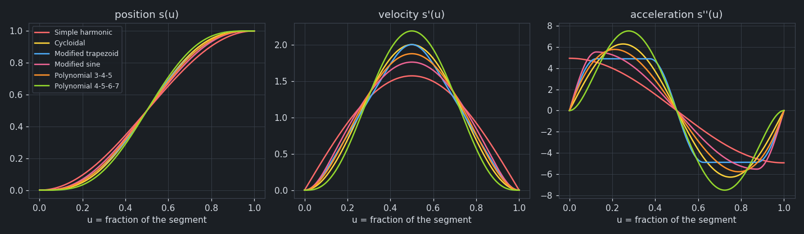
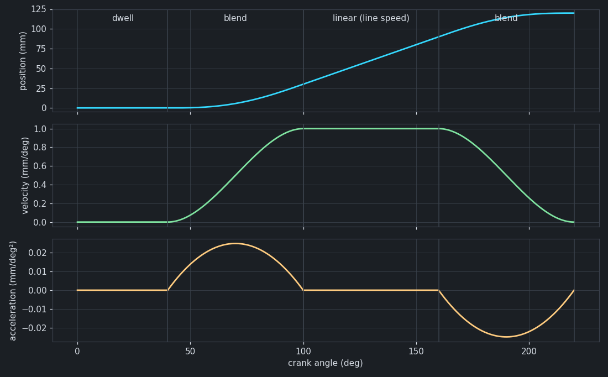
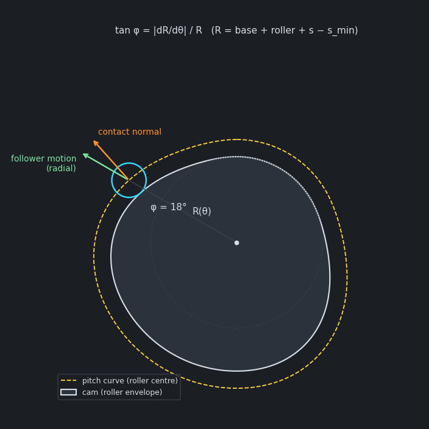

# The math and algorithms

How the Electronic CAM Workbench turns a profile into motion: the motion laws, the Blend and Cubic spline
laws, the analysis and speed limits, the plate-cam geometry, and the integer runtime the ClearCore runs. Every
formula here is the one in the code; each section names the file and function that implements it.

Formulas are written in plain text (Unicode), so they read the same on GitHub, in an editor's preview
or in a PDF.

**Contents.** [Notation](#1-notation) · [Motion laws](#2-motion-laws) ·
[Segments in real units](#3-a-segment-in-real-units) · [Blend](#4-blend-matching-the-neighbours) ·
[Cubic spline](#4a-cubic-spline-a-curve-through-points) ·
[The profile](#5-the-profile-knots-dwells-closed-and-open) · [Analysis](#6-analysis) ·
[Speed limits](#7-speed-limits) · [Cam geometry](#8-plate-cam-geometry) ·
[Mechanics](#9-mechanics-and-exact-gear-ratios) · [The runtime](#10-the-runtime-on-the-clearcore) ·
[Electronic gear](#10a-the-electronic-gear) ·
[Hashes](#11-hashes-and-checksums)

## 1. Notation

| Symbol | Meaning |
|---|---|
| x | master position: crank angle in degrees (0–360) or timeline time in seconds |
| s(x) | follower position in the axis's units (mm, deg, …) |
| s′, s″, s‴ | derivatives with respect to the master: units/deg, units/deg², units/deg³ (per second on a timeline) |
| u | fraction of a segment, 0 … 1 |
| ω | master rate: deg/s on the crank (6 × rpm), the speed override on the timeline |
| α | crank angular acceleration while a driven crank ramps, deg/s² |
| V, A | an axis's velocity and acceleration limits, units/s and units/s² |

Per-master derivatives become per-second values by the chain rule at constant master speed
(`MasterRate`, `DegPerSecond` in `core/CamProfile.h`):

```text
velocity     = s′ · ω
acceleration = s″ · ω²
jerk         = s‴ · ω³
```

While the master accelerates there is one more term, see [7](#7-speed-limits).

## 2. Motion laws

Each law is a normalized function S(u) plus its derivatives S′, S″, S‴ with respect to u (`EvaluateLaw`,
`core/CamLaws.cpp`). A rise law has S(0) = 0 and S(1) = 1; a Dwell is S = 0.



**Sinusoidal-acceleration laws** (simple harmonic, cycloidal, modified trapezoid, modified sine) are
built from pieces whose acceleration is a constant plus a sine; a piece starts at uₐ:

```text
S″(u) = c + k · sin(w·t + φ)          with t = u − uₐ
```

Each piece is integrated twice in closed form, continuing the velocity and position where the previous
piece ended:

```text
S′(u) = S′(uₐ) + c·t + (k/w) · (cos φ − cos(w·t + φ))
S(u)  = S(uₐ) + S′(uₐ)·t + ½·c·t² + (k/w)·t·cos φ − (k/w²) · (sin(w·t + φ) − sin φ)
```

(a piece with w = 0 is constant acceleration). The whole law is then divided by S(1) so the rise is
exactly 1 (`Build`, `EvalPieceLaw`).

| Law | Pieces of S″ (before scaling) |
|---|---|
| Simple harmonic | cos(π·u) on 0 … 1 |
| Cycloidal | sin(2π·u) on 0 … 1 |
| Modified trapezoid | sin(4π·u) to ⅛ · 1 to ⅜ · cos(4π·(u − ⅜)) to ⅝ · −1 to ⅞ · −cos(4π·(u − ⅞)) to 1 |
| Modified sine | sin(4π·u) to ⅛ · cos(4π/3·(u − ⅛)) to ⅞ · −cos(4π·(u − ⅞)) to 1 |

**Polynomial laws:**

```text
3-4-5:      S(u) = 10u³ − 15u⁴ + 6u⁵
4-5-6-7:    S(u) = 35u⁴ − 84u⁵ + 70u⁶ − 20u⁷
```

3-4-5 has zero velocity and acceleration at both ends; 4-5-6-7 also zero jerk. **Linear** is S = u,
S′ = 1. **Dwell** is S = 0 (its end position is tied to its start, see
[5](#5-the-profile-knots-dwells-closed-and-open)).

The peak coefficients Cv = max |S′| and Ca = max |S″| are what `tests/test_camlaws.cpp` checks against
the published values (Norton, *Cam Design and Manufacturing Handbook*), along with finite-difference
checks of every derivative:

| Law | Cv | Ca | At the ends |
|---|---|---|---|
| Simple harmonic | 1.5708 | 4.9348 | acceleration steps |
| Cycloidal | 2.0000 | 6.2832 | zero acceleration |
| Modified trapezoid | 2.0000 | 4.8881 | zero acceleration, lowest Ca |
| Modified sine | 1.7596 | 5.5280 | zero acceleration, low Cv |
| Polynomial 3-4-5 | 1.8750 | 5.7735 | zero acceleration |
| Polynomial 4-5-6-7 | 2.1875 | 7.5132 | zero acceleration and jerk |

## 3. A segment in real units

A segment from (x₀, p₀) to (x₁, p₁) has span w = x₁ − x₀ and rise h = p₁ − p₀. With u = (x − x₀) / w
(`EvaluateSegment`, `core/CamProfile.cpp`):

```text
s  = p₀ + h · S(u)
s′ = (h / w)  · S′(u)
s″ = (h / w²) · S″(u)
s‴ = (h / w³) · S‴(u)
```

So for a given law, peak velocity grows with h / w and peak acceleration with h / w²: halving a
segment's span quadruples its acceleration.

## 4. Blend: matching the neighbours

All the laws above except Linear start and end at rest, so a segment that has to *reach a speed* (a
carriage catching up with a moving line) needs something else: Linear jumps to its speed at once, a
velocity step. **Blend** starts at the velocity where the previous segment ends and finishes at the
velocity where the next one starts, with zero acceleration at both ends (`EvaluateSegment`,
`BlendNeighbourVel`).

It is the quintic Hermite curve with six end conditions: position p₀ → p₀ + h, velocity v₀ → v₁,
acceleration 0 → 0. With the end velocities per unit of u, v̂₀ = v₀·w and v̂₁ = v₁·w:

```text
s(u) = p₀ + h·P(u) + v̂₀·B₀(u) + v̂₁·B₁(u)

P(u)  = 10u³ − 15u⁴ + 6u⁵        the rise:            P(1) = 1, flat at both ends
B₀(u) = u − 6u³ + 8u⁴ − 3u⁵      the start velocity:  B₀′(0) = 1, all else 0 at both ends
B₁(u) = −4u³ + 7u⁴ − 3u⁵         the end velocity:    B₁′(1) = 1, all else 0 at both ends
```

Derivatives are taken term by term and divided by w, w², w³ as in [3](#3-a-segment-in-real-units).

**The neighbours.** v₀ is the velocity at the end of the previous segment, v₁ at the start of the next.
On a crank the profile wraps (the segment before the first is the last; an open profile's advance is
only an offset, so its velocity wraps too). Before a timeline axis's start and after its end it is at
rest. A neighbour that is itself a Blend counts as at rest, so Blends never depend on each other.
Between two rests (v₀ = v₁ = 0) Blend is exactly the 3-4-5 polynomial.

**The natural rise.** For a Blend from rest to a speed v, any rise works, but h = ½·v·w (the distance
covered at the average speed) gives the cleanest motion. Substituting:

```text
s(u) = v·w · (u³ − ½u⁴)
s′   = v · (3u² − 2u³)
s″   = (6v / w) · u · (1 − u)
```

The velocity rises monotonically from 0 to v (a smoothstep), the acceleration is a single positive hump
with peak 1.5·v / w, and nothing overshoots. A larger rise makes the velocity overshoot v and come back;
a smaller one undershoots.



*Example* (`samples/true_flying_cutoff.ecam`): the line moves 1 mm per crank degree. The carriage dwells
to 40°, blends 40–100° (w = 60°, h = 30 mm = ½ · 1 · 60), rides the line 100–160° on a Linear segment
(s′ = 1 mm/deg exactly), and blends 160–220° back to rest. Peak acceleration in the blends:
1.5 · 1 / 60 = 0.025 mm/deg²; at 8 rpm (ω = 48 °/s) that is 0.025 · 48² = 57.6 mm/s². `test_camlaws`
checks that this profile has no velocity or acceleration step, that the sync is at line speed, and the
derivatives against finite differences.

## 4a. Cubic spline: a curve through points

Every other law is a closed form between two knots. **Cubic spline** is for a shape given by points: a run of
consecutive Spline segments is one curve through all their knots, a cubic on each piece, with position,
velocity and acceleration continuous at every knot inside the run (`FitSplines`, `EvaluateSegment`). The
method is the one in [Ruye Wang's notes](https://pages.hmc.edu/ruye/MachineLearning/lectures/ch7/node6.html).

**The piece.** The unknowns are the second derivatives Mᵢ at the knots. Between knots xᵢ₋₁ and xᵢ, with
hᵢ = xᵢ − xᵢ₋₁, the second derivative is a straight line from Mᵢ₋₁ to Mᵢ, and integrating it twice with
the knot positions as the constants gives:

```text
C(x) = Mᵢ₋₁·(xᵢ − x)³ / 6hᵢ  +  Mᵢ·(x − xᵢ₋₁)³ / 6hᵢ
     + (yᵢ₋₁/hᵢ − Mᵢ₋₁·hᵢ/6)·(xᵢ − x)  +  (yᵢ/hᵢ − Mᵢ·hᵢ/6)·(x − xᵢ₋₁)
```

Position and acceleration now match at every knot by construction. Jerk is constant on each piece,
(Mᵢ − Mᵢ₋₁)/hᵢ.

**The equations.** Velocity matching at each inner knot gives, with μᵢ = hᵢ/(hᵢ + hᵢ₊₁) and λᵢ = 1 − μᵢ:

```text
μᵢ·Mᵢ₋₁ + 2·Mᵢ + λᵢ·Mᵢ₊₁ = 6·f[xᵢ₋₁, xᵢ, xᵢ₊₁]

f[xᵢ₋₁, xᵢ, xᵢ₊₁] = (f[xᵢ, xᵢ₊₁] − f[xᵢ₋₁, xᵢ]) / (xᵢ₊₁ − xᵢ₋₁)
```

The matrix is tridiagonal and strictly diagonally dominant, so the Thomas algorithm solves it with no
pivoting, in time proportional to the knots. Only the slopes f[xᵢ₋₁, xᵢ] enter, which is why an open
profile's advance across the wrap needs no special handling.

**The ends.** Two more equations are needed, and the run's neighbours decide them:

| Next to the run | End | Rows of the matrix |
|---|---|---|
| Any other law (a dwell is velocity 0) | Clamped to its velocity v | 2·M₀ + M₁ = (6/h₁)·(f[x₀, x₁] − v) |
| The start or end of a timeline axis | Clamped to 0: it rests there | the same, v = 0 |
| A Blend | Natural | M₀ = 0 |
| Nothing: every segment of a cycle is Spline | Periodic | the equation above, wrapped |

The right end mirrors the left: Mₙ₋₁ + 2·Mₙ = (6/hₙ)·(v − f[xₙ₋₁, xₙ]).

A clamped end keeps the velocity continuous but not the acceleration, so a spline leaving a dwell has an
acceleration step, which the analysis reports. The natural end is what makes a Blend the smooth exit: a Blend
has zero acceleration at its ends, the natural end has M = 0, and the Blend takes the spline's velocity,
so the join is continuous in position, velocity and acceleration. (A spline next to a Blend never reads the
Blend's velocity, and that is what keeps the two from depending on each other.)

**Periodic.** With the knot after the last being the first, the matrix gains two corner entries, β = μ₀ at
the top right and α = λₙ₋₁ at the bottom left. Sherman-Morrison removes them: with γ = −2, T is the
tridiagonal part with its first diagonal entry less γ and its last less αβ/γ. Solving T·y = d and T·z = u, for
u = (γ, 0, …, 0, α):

```text
M = y − z · (y₀ + β·yₙ₋₁/γ) / (1 + z₀ + β·zₙ₋₁/γ)
```

Two knots are solved directly; one piece around the cycle is a straight line.

**Splitting** a segment adds a knot on the curve. The spline through the same points with the same ends is
unique, so the new one is identical, and `SplitAt` changes nothing until the knot is moved.

**Overshoot.** A spline knows nothing of the range drawn, and swings past its points when they change
direction sharply. `Analyze` reports `SplineOvershoot` when a spline segment passes the axis's highest or
lowest knot by over 2 % of their range.

**On the board.** Nothing new runs in the sample interrupt: the runtime's table samples the curve like any
other law's ([10](#10-the-runtime-on-the-clearcore)), solved once per axis (`SplineFit`). A cubic in the
interrupt would buy nothing, since the linear interpolation between table entries is off by h²/8·|s″|: 0.03
counts for a 20 mm rise at 800 counts/mm in 120°, against the table's own ±0.5 of rounding.

`test_camlaws` checks a cubic reproduced exactly on uneven knots, the equations above on the solved M at
every knot, a natural case worked by hand (knots (0, 0), (1, 1), (2, 0): M₁ = −3, end slope 1.5), periodic
through the wrap and within 2·10⁻⁵ of a 24-knot sine, derivatives against finite differences, and splitting.

## 5. The profile: knots, dwells, closed and open

An axis is a list of segments over its master span (360° on the crank, the duration on the timeline);
the segment boundaries are **knots** (`core/CamProfile.cpp`).

- **Dwells are tied.** A Dwell's end knot always has its start knot's position. Knots are grouped by
  these ties (a small union-find, `KnotGroups`) and every knot takes the value of the lowest-index knot
  of its group, so dragging the knot before a dwell moves the whole dwell.
- **Closed** profiles tie the last knot to knot 0: the follower is back where it started every
  revolution. **Open** profiles do not: they advance by Δ = `s_end` − `s_start` every revolution or cycle
  (an index feed).
- **Cyclic.** A crank axis wraps from 360° straight into 0°; so does a repeating timeline axis that is
  as long as the cycle. Other timeline axes rest at their start before 0 and at their end after their
  duration. Step checks ([6](#6-analysis)) include the wrap on cyclic axes and the start / end at rest
  otherwise.
- **Changing master** keeps the shape: crank → timeline scales the segment ends so one revolution at
  the current speed becomes seconds, T = 60 / rpm; timeline → crank scales the duration to 360°
  (`SetAxisMaster`, `ScaleSpan`).
- The smallest segment is 0.5° on a 360° crank, scaled with the span on a timeline.

## 6. Analysis

`Analyze` (`core/CamProfile.cpp`) samples the axis at 3600 points per span (1440 in the speed-limit
helpers) and reports, for the panel in the window (`MainWindow::RefreshStats`):

- **Stroke and peaks:** min / max position, and the peaks of |s′|, |s″|, |s‴| with where they occur,
  shown per second as |s′|·ω, |s″|·ω², |s‴|·ω³.
- **Motor** (c = motor counts per unit, N = master counts per crank revolution):

  ```text
  peak step rate   = max|s′| · ω · c                 counts/s
  peak motor speed = 60 · peak step rate / ppr       rpm
  ratio (crank)    = max|s′| · c · 360 / N           motor counts per master count, at the steepest point
  ```

- **Steps at the knots.** At every knot the one-sided values of the segment ending there (left) and the
  one starting there (right) are compared, on a cyclic axis also across the wrap, and on a timeline with
  the axis at rest before its start and after its end:

  ```text
  velocity step:      |s′_left − s′_right| > 1e-6 · max(|s′_left|, |s′_right|) + 1e-9
  acceleration step:  |s″_left − s″_right| > 1e-6 · max(|s″_left|, |s″_right|) + 1e-12
  ```

  A velocity step means infinite acceleration (an error, red); otherwise an acceleration step means
  infinite jerk (a warning, amber). The displacement diagram marks each problem with a warning sign over the
  curve and a dashed line through the plots; hovering the sign says what it is and what to do.
- **Cam drawing:** pressure angle and undercut, [8](#8-plate-cam-geometry).

## 7. Speed limits

**Crank axes.** At crank speed ω and crank acceleration α the follower's acceleration is

```text
acceleration = s″·ω² + s′·α
```

(the second term is the follower being dragged faster as the crank speeds up). With limits V and A, the
fastest safe crank speed is the smallest, over the whole profile, of

```text
ω ≤ V / |s′|
ω ≤ √( (A − |s′|·α) / |s″| )
```

both terms taken at their worst sign. If |s′|·α ≥ A anywhere, no speed is safe: the ramp itself is too
steep. The steepest ramp the profile allows is `α_max` = A / max|s′| (`MaxMasterSpeed`,
`core/CamProfile.cpp`). α is the driven crank's ramp (6 × its rpm/s); an encoder master is not ours to
ramp, so α = 0 there (`RampDegPerSecond2`). The Crank panel shows the lowest limit over all crank axes
(and a driven crank's motor maximum), green when the set speed is below it
(`MainWindow::ProjectSpeedLimit`).

**Timeline axes.** The master rate is the speed override (seconds of diagram per second), with no ramp
term: the timeline starts at speed because every axis starts from rest. The same formulas with α = 0
give the highest safe override (`MainWindow::TimelineOverrideLimit`).

## 8. Plate-cam geometry

The cam view and the DXF draw each crank axis as a plate cam with a translating radial roller follower
at 12 o'clock; the cam turns clockwise. These drawings do not affect the motion: base radius `R_b` and
roller radius `r_r` are drawing settings.



**Pitch curve** (the roller centre's path, `PitchPointAndNormal`, `core/CamGeometry.cpp`): in the cam's
frame the follower is at angle 90° + θ, at radius

```text
R(θ) = R_b + r_r + s(θ) − s_min
```

**Pressure angle** φ (`Analyze`): the angle between the follower's motion (radial) and the contact
normal,

```text
tan φ = |R′| / R          with R′ = dR/dθ per radian = s′ · 180/π
```

Above 30° the follower is pushed sideways more than along its guide; Analysis flags it.

**Radius of curvature** of the pitch curve, as a polar curve R(θ):

```text
ρ = (R² + R′²)^(3/2) / (R² + 2·R′² − R·R″)
```

Where the denominator is positive the pitch curve is convex. **Undercut**: where a convex part has
ρ < `r_r`, the roller is larger than the curve it should follow and would cut its own path; flagged.

**The cam outline** is the envelope of the roller (`BuildCamShape`). For each ray from the cam centre
(unit vector û), the surface is where the ray first enters any roller circle centred on the pitch curve;
the cam is everything the roller never reaches. For a pitch point P:

```text
a = P · û                 (along the ray)
b = |P × û|               (across it)
t = a − √(r_r² − b²)      where the ray hits that roller (when a > 0 and b ≤ r_r)
```

The surface radius on that ray is the smallest t over the pitch points that can reach it. A roller at
radius ≥ `R_b` + `r_r` spans at most arcsin(`r_r` / (`R_b` + `r_r`)) either side of its centre, so only that
window of samples is searched. Where the profile is smooth this is the pitch curve offset by `r_r` along
its normal; at a velocity step (a corner in the pitch curve) it trims an inside corner's overlap and
rounds an outside corner; at the drop of an open profile it cuts the relief the roller rolls off by. The
DXF writes this outline with 360–36000 points per revolution.

## 9. Mechanics and exact gear ratios

**Counts per unit** from the drive (`DriveCountsPerUnit`):

```text
Direct:     c = as entered
Ballscrew:  c = ppr / pitch
Belt:       c = ppr / (π · pulley pitch diameter)
```

**Master counts.** With a gear ratio n : d (motor or encoder turns : crank turns) the crank has
N = ppr · n / d counts per revolution. N need not be whole (800 ppr at 50 : 7 is 5714.29), so the board
never counts in counts: it counts in **units of 1/d of a count**, with M = ppr · n units per crank
revolution, a whole number (`CrankUnitsPerRev`). Each encoder count or crank-motor step is d units.

At 800 ppr and 50 : 7: M = 40000 units per crank turn and a step is 7 units, so every 7 crank turns are
exactly 7 · 40000 / 7 = 40000 steps. The crank's 0° never creeps, however long it runs. M is limited to
2·10⁹ (`kMaxCrankUnits`).

## 10. The runtime on the ClearCore

`core/CamRuntime.cpp` runs on the board in the 5 kHz sample interrupt (and on the PC in
`tests/test_runtime.cpp`). `Build()` does the floating-point work once, in the main loop, when a profile
is loaded; `Tick()`, every 200 µs, uses integers only.

**Tables.** Each axis is sampled at K + 1 = 2049 evenly spaced master positions into motor counts, in
double precision (the last entry from the end of the last segment):

```text
T[k] = round( s(k · span / K) · c )          k = 0 … 2048
```

Between entries the runtime interpolates linearly, with a 16-bit fraction f (0 … 65535); the shift rounds
down:

```text
target = T[i] + ((T[i+1] − T[i]) · f) >> 16
```

The interpolation error is at most ⅛ · Δx² · max|s″| · c counts with Δx = span / 2048. On a crank
Δx = 0.176°, so for |s″| = 0.025 mm/deg² and c = 160 counts/mm it is 0.015 counts: well below a step.

**Fixed point.** "Q24" and "Q16" mean a value multiplied by 2²⁴ or 2¹⁶ and kept as an integer (a binary
fraction):

| Quantity | Representation |
|---|---|
| crank phase | master units within the revolution, Q24, in an int64, plus a revolution count (int32) |
| crank velocity | master units per sample, Q24 |
| timeline time | samples into the cycle, Q16, plus a cycle count |
| timeline rate | Q16, 65536 = speed override 1.0 |

The crank phase stays below M · 2²⁴ ≤ 2·10⁹ · 2²⁴ ≈ 3.4·10¹⁶, far inside an int64; whole turns go into
the revolution count, so a long run never overflows. With φ the phase in whole units and D the cycle as
drawn (D = M except in cut-length mode), the table index and fraction are

```text
i = ⌊ φ · K / D ⌋
f = ((φ · K mod D) << 16) / D
```

On a driven crank or a jog the phase's fraction of a unit is added to f. The timeline divides by the axis's
span in samples the same way.

**Crank master.**

- *Encoder:* each sample the phase moves by the encoder's change times d (Δphase = Δcounts · d, in
  Q24). The 32-bit counter's wrap is harmless because the change is taken in 32 bits. The callback sees
  the previous sample's encoder reading.
- *Driven crank:* the velocity moves toward its target by at most the ramp per sample, both in Q24:

  ```text
  target velocity = rpm · M / 60 / 5000             units per sample
  ramp            = (rpm/s) · M / 60 / 5000²        units per sample, per sample
  ```

  The crank motor gets ⌊ units / d ⌋ steps in total (floor, also below zero), output as the change each
  sample.

**Cut-length mode.** The encoder measures the line at q counts/mm (encoder counts per rev / wheel
circumference). The profile is drawn over a design cycle of D counts (design length × q, rounded); the
cycle actually cut is C counts, which can change:

```text
C = round( (piece + kerf) · q )            the cycle, cut to cut
x = max( 0, phase − (C − D) )               where in the drawn cycle the line is
```

Everything is looked up at x instead of the phase (axis tables, crank output pulses). The drawn cycle
starts with a wait W (design counts) in which every crank axis dwells, and x stays inside it while
phase < C − D + W: a longer cycle (C > D) holds x at 0 longer, a shorter one (C < D) starts x part way
into the wait. After the wait, x and the phase advance together, so the accelerate / sync / decelerate /
return part keeps its line distance: the carriage's speeds and accelerations at a given line speed do
not depend on the length, and neither do the limits. The shortest cycle is D − W (the wait gone), so
the shortest piece is (D − W) / q − kerf.

**The cut line.** The sync is the carriage's first Linear segment, from S₀ to S₁ (design counts). A
material point passes the blade's home position and is met by the blade when the carriage reaches the
sync start: that point is the cut line. Its distance behind the blade, in line counts, is the line still
to travel to the next sync start less the carriage travel still to go to its sync position:

```text
next sync start  N = (C − D + S₀)                        until this cycle's sync is over (phase < C − D + S₁)
                 N = C + (C_next − D + S₀)                after it (the next cycle, at its length)
gap = (N − phase) − (c(S₀) − c_now) · q / c_mm           c in carriage motor counts, c_mm its counts per mm
```

In the sync the carriage moves with the line, so the gap is 0 there; the board reports it as on the cut
line, with the line left before S₁. Before the sync it shrinks at the line speed during the wait and more slowly
while the carriage accelerates. Consecutive cut lines are exactly C apart on the material, and a new
length (taken at the wrap) applies to the next piece.

A new C is taken when the phase wraps, so the cut under way
finishes at its old length; while the crank is off it is taken at once, and while hand jogging when the
jog ends (jog targets are whole turns of the length the jog started with). `test_runtime` checks a 600 mm
cycle changed to 503 mm mid-cut: the new length starts with the next cut, cuts are exactly C counts
apart, and the carriage stays within one count of its drawn profile at both lengths.

**Timeline.** Time advances by the rate each sample. At the trigger the rate starts at the override
(every axis starts from rest). A change of override ramps to full in 0.25 s (65536 / 1250 per sample).
One-shot ends at the cycle length (the longest timeline axis or the last timeline output pulse); repeat wraps
and counts cycles. Stop is a cycle stop: a running timeline finishes its cycle and rests at its end; a second
Stop ramps the rate to zero over `stop_ms`.

**Steps are differences.** Each sample, an engaged axis's motor gets `target_now` − `target_last` steps.
Engaging sets `target_last` to the current target first, so engaging never jumps: wherever the motor is
is taken as the profile position at that moment. An open profile adds its advance Δ · c once per
revolution or cycle.

**Hand jog** moves the master toward a target with a velocity and acceleration limit (`JogVelocity`).
Each sample the wanted speed toward the target is

```text
v = min( v_max, √(2 · a · |e|) )          e = distance left
```

approached by at most a per sample; the last step lands on the target. The limits are the profile's
crank speed or timeline speed, reached in a quarter second (a driven crank uses its ramp).

**Outputs.** Pulse ends are converted once at load: a crank pulse to master units, round(x / 360 · M);
a timeline pulse to samples, Q16. Each sample an output is on when its master is engaged / running and
the phase or time is in [on, off). The pins are written only when the result changes (`CamEngine.cpp`),
and never in simulate.

**Steps to the drive** (Enhanced ClearCore Library, `MotorDriver::ApplySampleSteps`). The steps for a
sample go out over the following 200 µs. Beyond the step timer's per-sample maximum they are carried
into the next samples, not lost. The direction output only changes with no pulses in flight: a sample
with no steps leaves it alone, and a reversal right after a sample that sent steps waits one sample
(the steps are carried). A drive that reads DIR slightly after the step edge therefore never counts a
step the wrong way; `test_runtime` checks the net steps and no drift over 20 revolutions.

## 10a. The electronic gear

An axis marked as a gear has no diagram: it travels `gearNum` units for every `gearDen` crank revolutions. In
the model it is one open Linear segment of gearNum / gearDen units per revolution, which is what a constant
ratio is, so the diagrams, the analysis and the speed limits need nothing new (`Normalize`).

The runtime cannot use that segment. The table holds whole counts, so the advance per revolution would round:
3 : 7 of an 800-count motor is 342.857… counts a revolution, and at 343 the axis would gain a count every 7
revolutions, for ever. So a gear has no table, and instead keeps a fraction. With U master units per
revolution (`CrankUnitsPerRev`):

```text
P / Q = countsPerUnit · gearNum / (gearDen · U)          motor counts per master unit, whole numbers

each sample, with Δ the master's motion in whole units:
    acc += Δ · P
    q    = ⌊acc / Q⌋
    acc −= q · Q                                          0 ≤ acc < Q
    steps += q
```

Nothing is rounded away: acc carries the remainder, so after any motion the position is exactly
⌊u · P / Q⌋ for the master's total u, in either direction, and returning the master returns the axis to the
count. The floor keeps the remainder positive going backwards, so forward and back are the same function
of u.

Δ is the crank's motion before its phase wraps, added up in Q24 wherever the phase moves: the encoder's
change, the driven crank's velocity, a hand jog. So ramps, jogs and stops need nothing of their own, and a gear
engages and lets go with the crank axes. In cut-length mode U is the cycle as drawn, not the cycle now, so
a gear keeps its ratio to the line while the cut length changes.

A `countsPerUnit` that is not whole (a belt: motor ppr / (π · d)) has no exact fraction. It is doubled, with Q,
until it is whole or the numerator reaches 2³⁷, which keeps Δ · P inside 64 bits for 2²⁴ units in one sample
and leaves an error under 1 part in 2³⁸. `Build` refuses a ratio whose numerator starts at 2³⁸ or more, or whose
Q starts above 4·10¹⁸.

`test_runtime` compares every sample to the integer formula for seven ratios from 1 : 1000 to 997 : 991, reversed
too, forward and back through zero, and to the count after 280 000 revolutions; a 50 : 7 crank; a belt; a driven
crank through its ramps against its own motor; hand jog; restarting; cut-length mode with a changing cut.

## 11. Hashes and checksums

- **Profile hash** (`ProfileHash`, `core/ProfileText.cpp`): 32-bit FNV-1a over every upload line, each
  followed by `\n`:

  ```text
  h = 2166136261
  for each byte b:  h = (h XOR b) · 16777619   (mod 2³²)
  ```

  The app and the board compute it over the same lines (including the project copy), so equal hashes
  mean the board runs exactly this project.
- **Flash store** (`Firmware/ECamFirmware/FlashStore.cpp`): the same FNV-1a over the stored text, in the
  header next to its length; a stored profile whose checksum does not match is ignored at boot.
- **Settings** (`Settings.cpp`): FNV-1a over the settings block, with a magic word and version.
